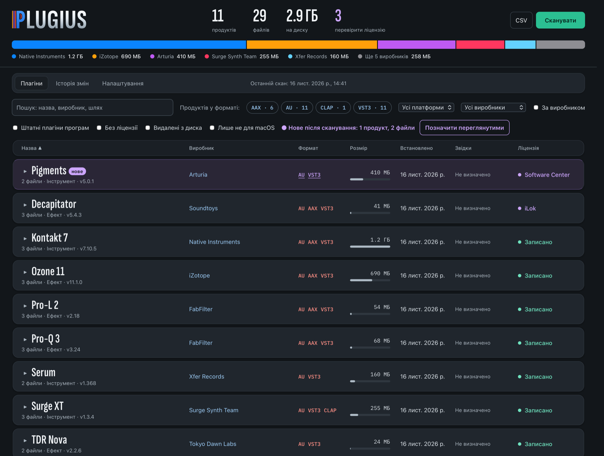

# Plugius

A local catalog of the audio plugins installed on your Mac: what you have, where it came from, when it was installed, and where its licence lives.

[Українською](README.uk.md)



*The screenshot shows demo data. The interface is currently in Ukrainian; English is planned.*

## Why

After a few years of music production, nobody remembers which vendor account a plugin was bought on, whether its licence is an iLok, a key in an email or a file somewhere in `Application Support`, or why a reverb from 2019 is still taking up a gigabyte. Plugius scans your plugin folders and keeps that memory for you.

## Features

- **All formats:** AU, VST2, VST3, AAX, CLAP, LV2, RTAS, and also Windows `.dll` / `.vst3` and Linux `.so` files that ended up on the Mac.
- **One row per product:** the AU, VST3 and AAX versions of the same plugin are grouped together, with the files one click away.
- **Install date** from the macOS package receipts and install history, with a fallback to the file date. Dates older than the Mac itself are marked as possibly migrated.
- **Where it came from:** package ID, the "downloaded from" mark of the installer, or a similar installer in `~/Downloads`.
- **Licence hints:** known licence locations per vendor, with your own notes taking priority.
- **Your notes are never overwritten:** source, licence, description, vendor and notes you type stay as they are after every scan.
- **Disk usage by vendor** and size bars per plugin.
- **New plugins are highlighted** after each scan, removed ones stay in the list as "removed from disk".
- **Stock plugins** of Logic Pro and Pro Tools are hidden by default.
- **Weekly automatic scan** (launchd) and CSV export.
- **Offline:** nothing leaves your Mac. The app listens only on `127.0.0.1`.

## Status

Plugius is a young personal project. It works on the author's Mac every day, but it has not been tested on many other machines yet. The licence locations are verified only for a handful of vendors; the rest are best guesses, and you can correct them in the rules files.

## Requirements

- macOS 11.3 or later, Apple Silicon or Intel.
- Nothing else to run the app: it ships its own Python and a prebuilt universal window, so Command Line Tools are not needed.
- To build it yourself: Command Line Tools for Xcode (`xcode-select --install`) and about 50 MB to download Python once.

## Run it

Build the app:

```bash
git clone https://github.com/alanmortus-plug/plugius.git
cd plugius
python3 tools/fetch_python.py   # once: downloads Python 3.13 for Apple Silicon and Intel, checks SHA-256
python3 tools/build_app.py
```

`dist/Plugius-app.zip` (about 18 MB) is the whole app. Unzip it, move `Plugius.app` wherever you like and open it.

The app is not notarized by Apple, so the first time macOS refuses to open it. Open System Settings → Privacy & Security, scroll down and click Open Anyway next to the message about Plugius. Or run:

```bash
xattr -dr com.apple.quarantine Plugius.app
```

Or run it in your browser without building anything:

```bash
python3 app/pluginvault.py serve
```

and open http://127.0.0.1:8765.

## Your data

Everything lives in `~/Library/Application Support/PluginVault/`: the database, the scan log and three rules files you can edit (`stock_rules.json`, `license_rules.json`, `vendor_rules.json`). When the app is updated, new default rules are merged in without overwriting your edits.

## How it works

Python 3 with the standard library only (the app bundles its own Python 3.13 from [python-build-standalone](https://github.com/astral-sh/python-build-standalone)), SQLite, and a small local web server. The interface is a single HTML file, and the desktop window is a thin Swift `WKWebView` shell. No dependencies, no network access.

## Contributing

The most useful help right now is rules: licence locations for vendors you use, and stock plugins of other DAWs. They are plain JSON in `app/rules/`. Run the tests before sending a change:

```bash
python3 tests/test_all.py
```

## Licence

MIT, see [LICENSE](LICENSE). The embedded fonts (Sofia Sans Extra Condensed and IBM Plex Mono) are under the SIL Open Font License, see [THIRD_PARTY.md](THIRD_PARTY.md).
