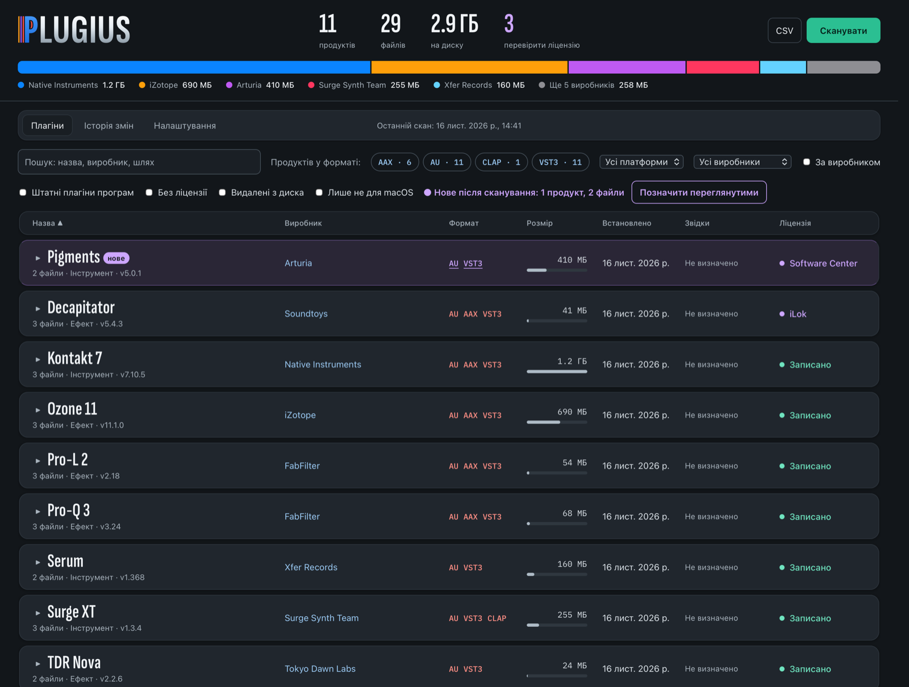

# Plugius

Локальний каталог музичних плагінів на твоєму Mac: що встановлено, звідки взялось, коли поставлено й де лежить ліцензія. Нічого не надсилає в інтернет.

[English](README.md)



*На скріншоті демонстраційні дані.*

## Можливості

- **Усі формати:** AU, VST2, VST3, AAX, CLAP, LV2, RTAS, а також Windows `.dll` / `.vst3` і Linux `.so`, що опинились на Mac.
- **Один рядок на продукт:** AU, VST3 і AAX одного плагіна зібрані разом, файли розгортаються одним кліком.
- **Дата встановлення** з журналу пакетів macOS, із запасним варіантом за датою файлу. Дати, старіші за сам Mac, позначаються як «перенесено?».
- **Звідки скачано:** ID пакета, позначка «завантажено з» в інсталятора або схожий інсталятор у `~/Downloads`.
- **Ліцензії:** відомі місця ліцензій за виробниками, ручні записи мають пріоритет.
- **Ручні записи не затираються:** джерело, ліцензія, опис, виробник і нотатки лишаються після кожного скану.
- **Місце на диску за виробниками** і смужка розміру в кожного плагіна.
- **Нові плагіни підсвічуються** після скану, видалені лишаються в списку як «видалені з диска».
- **Штатні плагіни** Logic Pro та Pro Tools сховані, є фільтр «Штатні плагіни програм».
- **Автоскан раз на тиждень** (launchd) і експорт у CSV.

## Вимоги

- macOS 11.3 або новіша, Apple Silicon чи Intel.
- Command Line Tools від Apple (поки що): `xcode-select --install`.

## Запуск

```bash
git clone https://github.com/alanmortus-plug/plugius.git
cd plugius
python3 tools/build_app.py
```

Розпакуй `dist/Plugius-app.zip` і відкрий `Plugius.app`. Перший запуск збирає вікно, до хвилини. Якщо macOS блокує застосунок: правий клік → Відкрити, або

```bash
xattr -dr com.apple.quarantine Plugius.app
```

Веб-версія без збирання: `python3 app/pluginvault.py serve`, далі http://127.0.0.1:8765.

## Дані

`~/Library/Application Support/PluginVault/`: база, лог і правила (`stock_rules.json`, `license_rules.json`, `vendor_rules.json`). Правила можна редагувати: оновлення застосунку додає нові типові правила, не затираючи твоїх правок.

«Звідки скачано» та шляхи ліцензій визначаються евристично, решту вписуй вручну.

## Тести

```bash
python3 tests/test_all.py
```

## Ліцензія

MIT, див. [LICENSE](LICENSE). Вбудовані шрифти мають ліцензію SIL Open Font License, див. [THIRD_PARTY.md](THIRD_PARTY.md).
